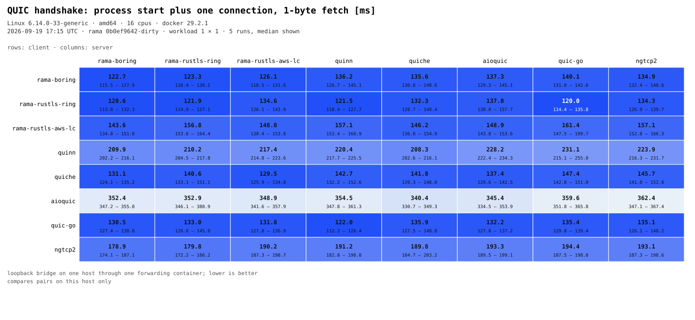
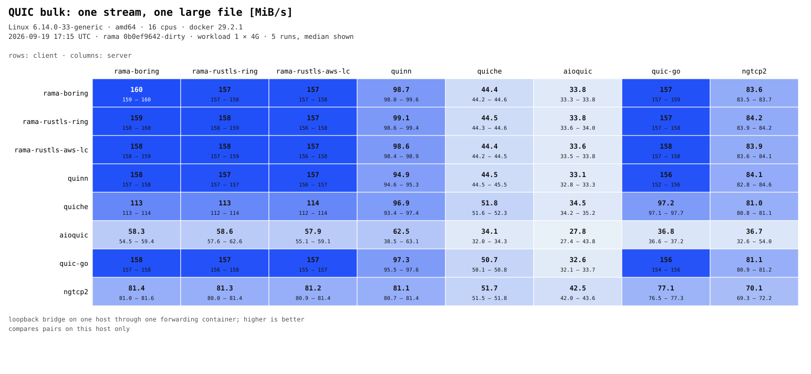
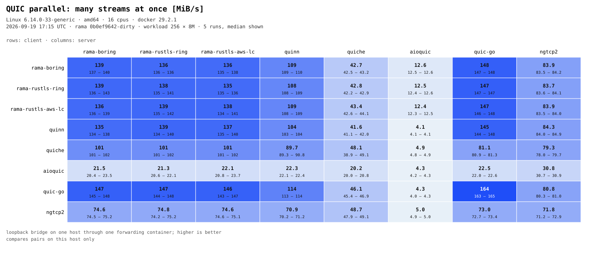
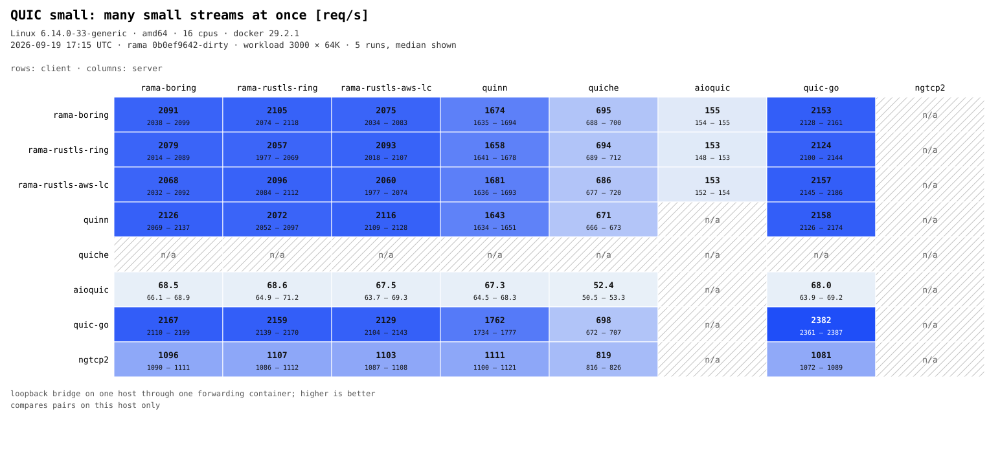

[![Crates.io][crates-badge]][crates-url]
[![Docs.rs][docs-badge]][docs-url]
[![MIT License][license-mit-badge]][license-mit-url]
[![Apache 2.0 License][license-apache-badge]][license-apache-url]
[![rust version][rust-version-badge]][rust-version-url]
[![Build Status][actions-badge]][actions-url]

[![Discord][discord-badge]][discord-url]
[![Buy Me A Coffee][bmac-badge]][bmac-url]
[![GitHub Sponsors][ghs-badge]][ghs-url]
[![Paypal Donation][paypal-badge]][paypal-url]

[crates-badge]: https://img.shields.io/crates/v/rama-quic.svg
[crates-url]: https://crates.io/crates/rama-quic
[docs-badge]: https://img.shields.io/docsrs/rama-quic/latest
[docs-url]: https://docs.rs/rama-quic/latest/rama_quic/index.html
[license-mit-badge]: https://img.shields.io/badge/license-MIT-blue.svg
[license-mit-url]: https://github.com/plabayo/rama/blob/main/LICENSE-MIT
[license-apache-badge]: https://img.shields.io/badge/license-APACHE-blue.svg
[license-apache-url]: https://github.com/plabayo/rama/blob/main/LICENSE-APACHE
[rust-version-badge]: https://img.shields.io/badge/rustc-1.96+-blue?style=flat-square&logo=rust
[rust-version-url]: https://www.rust-lang.org
[actions-badge]: https://github.com/plabayo/rama/actions/workflows/CI-status.yml/badge.svg?branch=main
[actions-url]: https://github.com/plabayo/rama/actions/workflows/CI.yml

[discord-badge]: https://img.shields.io/badge/Discord-%235865F2.svg?style=for-the-badge&logo=discord&logoColor=white
[discord-url]: https://discord.gg/29EetaSYCD
[bmac-badge]: https://img.shields.io/badge/Buy%20Me%20a%20Coffee-ffdd00?style=for-the-badge&logo=buy-me-a-coffee&logoColor=black
[bmac-url]: https://www.buymeacoffee.com/plabayo
[ghs-badge]: https://img.shields.io/badge/sponsor-30363D?style=for-the-badge&logo=GitHub-Sponsors&logoColor=#EA4AAA
[ghs-url]: https://github.com/sponsors/plabayo
[paypal-badge]: https://img.shields.io/badge/paypal-contribution?style=for-the-badge&color=blue
[paypal-url]: https://www.paypal.com/donate/?hosted_button_id=P3KCGT2ACBVFE

🦙 rama® (ラマ) is a modular service framework for the 🦀 Rust language to move and transform your network packets.
The reasons behind the creation of rama can be read in [the "Why Rama" chapter](https://ramaproxy.org/book/why_rama).

## rama-quic

QUIC for Rama — the transport that carries HTTP/3 and MASQUE. It gives you QUIC
client and server endpoints: encrypted, multiplexed streams and unreliable datagrams
over UDP, with the loss recovery, congestion control, connection migration and
path-MTU discovery a real deployment needs. TLS 1.3 comes from the shared `rama-tls`
config (BoringSSL or Rustls); the sockets from `rama-udp`.

QUIC v2 (RFC 9369) is supported and on by default. Rama negotiates the version per
RFC 9368 with downgrade protection and greases the QUIC bit (RFC 9287); the module
map below says where to shape or turn any of that off.

### Where things live

- **`driver`** — the async `Endpoint`, `Connection` and streams you actually build on.
- **`rama-quic-proto::version`** — which versions are offered and how negotiation resolves, through
  `ClientVersionPolicy` / `ServerVersionPolicy`. (Only BoringSSL can switch version
  mid-handshake; a Rustls client offers just its first-flight version.)
- **`profile`** — the wire image a client presents (version offer, transport-parameter
  order, connection-ID lengths, datagram size, frame layout) as a typed, checked
  `QuicProfile`, plus a parser to read a captured first flight back. The vocabulary and
  codec behind it live engine-free in [`rama-quic-proto`](../rama-quic-proto/), so a
  fingerprinting tool can depend on them without the engine.
- **`tls::provider`** — bring your own TLS 1.3 and packet protection; no built-in crypto
  backend required. The [GnuTLS interop project](e2e/gnutls-interop/) drives this seam
  with every Rama backend switched off.

### Backends

Pick one crypto backend: `boring` (BoringSSL), `rustls,ring`, or `rustls,aws-lc`.
`boring` pulls in neither ring, AWS-LC nor the Rustls engine. From the end-user `rama`
crate, enable the `quic` feature.

Qlog recording follows qlog schema draft 14 and QUIC events draft 13; see the
[`qlog` module](src/qlog/mod.rs) for scope and reader compatibility.

Learn more about `rama`:

- Github: <https://github.com/plabayo/rama>
- Book: <https://ramaproxy.org/book/>

## Benchmarks

Every pairing of QUIC implementations, measured through the public interop-runner endpoint
images on one host: rows are clients, columns are servers, Rama appears once per TLS
backend. Each chart names the host's OS, CPU count, the UTC time and the Rama commit it was
produced from. `just rama-quic/bench-matrix` regenerates them; see
[e2e/bench](e2e/bench/) for the cases and how the numbers are taken.

