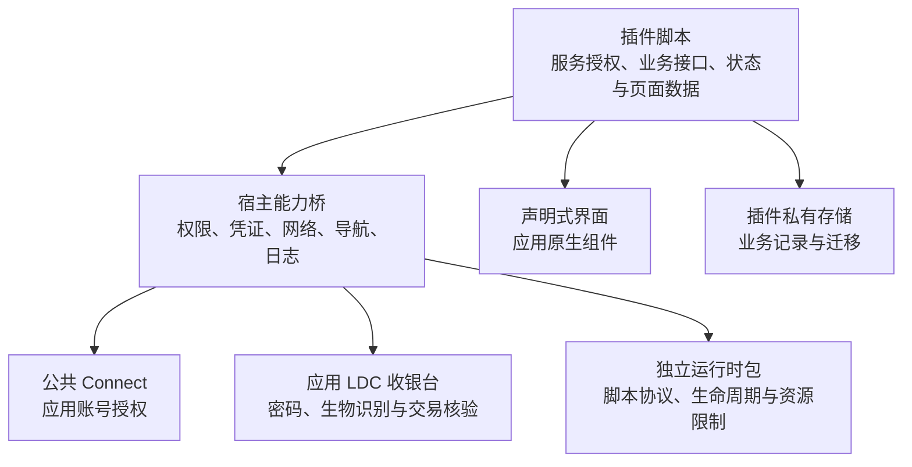

# 元宇宙第三方插件

开发入口见 [插件开发](plugins/README.md)。应用内「元宇宙 → 开发中心」可调整生产组件参数、触发事件并运行 API 示例。

## 结构与职责



服务初始化、回调内容解析、兑换服务令牌、商品、报价、订单幂等和交付刷新由插件实现。宿主按清单授权提供通用能力。付款能力属于应用，插件提交 LDC 支付地址、参考号和预期金额，应用通过 LDC 交易接口核验后返回结果。

## 插件包与清单

目录包含 `plugin.json`、`main.js`、`ui.rfwtxt`。用 `dart run tool/pack_metaverse_plugin.dart <目录> <输出文件>` 生成 `.fluxplugin`。三个远端资源须同源，导入时检查大小、清单、脚本路径和组件引用。

新插件声明 `schema: 9` 与 `apiVersion: 2`。完整示例见 [示例积分](examples/metaverse-plugin/plugin.json)，多页面业务示例见 [LD士多](../plugins/ld-store/README.md)。

| 字段 | 作用 |
| --- | --- |
| id、version、author | 稳定插件标识、语义版本和作者 |
| permissions.network | 精确域名或通配子域，限制脚本联网 |
| permissions.identity | 读取当前应用账号 ID 与用户名 |
| permissions.credentials | 具名凭证与 origin、路径、请求方法范围 |
| permissions.connect | 允许公共 Connect 返回的精确回调地址 |
| permissions.payments | 使用应用支付提供方，当前为 linuxDoCredit |
| permissions.publicImages | 使用匿名请求加载公网图片 |
| card、pages | 卡片与页面组件，页面可选择 modal 弹层及自管滚动 |
| links | 业务链接到插件页面的规则 |
| webLogin | 可选的网站会话入口 |

安装界面将权限按网络、账号、付款、链接和身份分组，可展开核对范围。同源更新保持安装身份，权限变化重新确认，跨来源安装提示数据影响。GitHub 目录负责索引与发布附件，客户端负责内容摘要和实际包校验。

## 界面描述

rfw 的文本格式，只能 `import fluxdo`（宿主组件库）。数据用 `data.xxx` 读，事件用
`event "名字" { 参数 }` 交给脚本：

```
import fluxdo;

widget Card = Column(
  crossAxisAlignment: "start",
  children: [
    Label(text: "当前积分", style: "labelMedium", color: "onSurfaceVariant"),
    Gap(size: 4),
    Label(text: data.balance, style: "headlineMedium", bold: true),
    Button(
      label: "刷新",
      icon: "refresh",
      variant: "tonal",
      loading: data.loading,
      onPressed: event "refresh" { },
    ),
  ],
);
```

可用组件（详见 `createMetaverseWidgetLibrary`）：

- 布局：`Row` `Column` `Stack` `Padding` `SizedBox` `Expanded` `ListView` `Wrap`
  等 rfw 自带组件（只放行了布局类，`Image` 与 `Container` 被换成宿主版本）。
- `Surface` `Label` `Button` `IconButton` `Symbol` `Image` `ListItem` `Divider`
  `Spinner` `ProgressBar` `Chip` `Gap` `Toggle` `TextInput`。

颜色写主题色名（`primary`、`onSurfaceVariant`、`error`…）或 `0xAARRGGBB`；
文字样式写主题名（`bodyMedium`、`titleMedium`、`headlineMedium`…）。
数值参数 `16` 与 `16.0` 都接受。

`Image` 默认只加载 `permissions.network` 中的 HTTPS 图片。声明
`permissions.publicImages: true` 后，用户可在安装时授权加载其他公网域名的图片。
图片请求携带宿主 User-Agent 和图片 Accept 头，使用独立的匿名客户端。单张下载上限为 16 MiB，解码尺寸限制为 1024 × 1024，加载失败后可点击重试。图片地址须直接返回图片，重定向按请求失败处理。

插件下载、API 与图片请求共用宿主的 DNS 选择。启用加密 DNS 时使用所选解析器，否则使用系统 DNS。直连筛选会拒绝回环、普通私网、链路本地等地址，并保留 `198.18.0.0/15` 和 `2001:2::/48` 中的 Fake-IP 候选，由系统路由送交 VPN。这两个范围只作为已通过域名审核的 DNS 结果使用，URL 中的 IP 字面量仍被拒绝。TLS 始终校验原域名。候选在截取数量上限前交错地址族，IPv6 不可达时可以尝试 IPv4。Dart 应急出口也使用同一解析快照并尝试备用连接。

插件通过 `fluxdo_net_plugin_request_start` 选择出口策略。应用内或系统显式代理收到原域名，由代理解析并选择目标。本地 DNS 失败或没有允许的直连候选时，传入空直连集合，核心仅可经代理访问。代理绕过规则选择直连时会拒绝该请求。客户端能够检查 URL 和本地直连候选，代理远端的地址访问范围由用户配置的代理策略控制。原 `fluxdo_net_pinned_request_start` 按调用方提供的 IP 建连。插件请求使用独立客户端、连接池和会话，旧核心或未启动核心时使用 Dart 直连应急出口。修改核心后需通过项目构建入口更新相应平台的原生库。


## 状态、日志与数据

同一插件的多个界面共享运行实例，每个界面使用独立 `ctx.surface`。事件处理通过 `ctx.api` 关联界面和调用日志。返回页面收到 `page.resume`，脚本依据业务变化决定刷新。

普通存储按插件隔离，账号相关业务键由插件自行分隔。凭证由宿主按插件及账号安全保存。插件设置提供日志查看、导出、清空和数据重置。旧实例晚到回调通过代次检查阻止写回。API、配额和事件详情见 [API 参考](plugins/api.md)。

API 1 的通用网络、界面和手填 token 继续兼容。旧服务授权与订单协议的实现已删除，相关已安装插件可保留数据并更新。旧记录由通用迁移入口原样导出，服务插件负责解释和转换。

## 运行与验证

运行时协议位于 `packages/fluxdo_plugin_runtime`。Flutter、原生引擎、网络和应用能力适配位于 `lib/modules/metaverse/plugin`。脚本隔离、调用限额和看门狗已具备，原生执行中断与内存硬上限仍需完成，详见 [架构实施记录](plugins/architecture-review.md)。

开发中心 API 示例使用模拟桥。登录、建单与付款回归采用固定响应，实际付款由用户在应用收银台确认。
