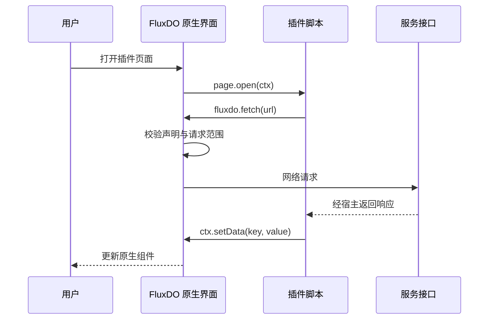

# 插件开发

本目录面向 FluxDO 插件作者。通用能力清单使用 schema 9、apiVersion 2。士多 2.0 使用 API 2，宿主在迁移期间继续支持 API 1。应用内「元宇宙 → 开发中心」提供组件预览、参数调整、事件记录和 API 模拟。

## 文档导航

- [API 参考](api.md)覆盖脚本环境、事件、网络、存储、账号、导航和应用支付接口。
- [组件参考](components.md)覆盖当前注册的宿主组件及 rfw 布局组件。
- [清单、权限与现有协议](../metaverse-plugin.md)介绍安装格式、网络限制和授权协议。
- [架构审计与改造方案](architecture-review.md)记录现状、参考项目、日志与数据管理、插件源和迁移验收。
- [最小示例](../examples/metaverse-plugin/)可用于首次安装与事件联调。
- [LD士多实现](../../plugins/ld-store/)展示多页面商城接入。

## 创建与安装

一个插件目录包含三个文件。

```text
my-plugin/
  plugin.json
  main.js
  ui.rfwtxt
```

`plugin.json` 声明身份、版本、资源文件、页面、网络和账号权限。`main.js` 处理服务协议和页面状态。`ui.rfwtxt` 声明通过宿主组件渲染的界面。

从最小示例复制后，修改唯一的 `id`、名称、版本、服务地址和页面。插件脚本在独立 JS 环境运行，通过 `fluxdo` 调用宿主。

在仓库根目录运行打包命令。

```sh
dart run tool/pack_metaverse_plugin.dart path/to/my-plugin build/my-plugin.fluxplugin
```

在应用的「元宇宙 → 添加第三方服务 → 从文件安装」选择产物，查看权限后安装并启用。也可把三个文件部署在同一 HTTPS 目录，从应用输入 `plugin.json` 的文件地址安装。

当前 `.fluxplugin` 的内容是 UTF-8 JSON，包含 `manifest` 和 `files`。打包工具检查资源路径，客户端负责清单、资源大小和 rfw 校验。安装失败时先核对 JSON、资源名称、页面引用与实际组件定义。

## 一次交互



同一插件的卡片和页面共用脚本运行实例。页面状态应按 `ctx.surface` 存放，避免两个详情页互相覆盖。`surface.close` 时删除页面状态。普通返回和应用恢复会收到 `page.resume`，可根据业务变化决定是否刷新。

## 兼容与调试

- `schema` 校验清单结构，`apiVersion` 声明脚本 API 版本。支持 1、2，不支持的版本会在安装时拒绝。
- 网络、凭证和跳转检查由 Dart 宿主执行。使用公开 SDK 即可获得一致的检查行为。
- `console` 写入结构化日志，包含插件 ID、版本和运行实例。插件管理中的日志入口支持查看、导出与仅清空当前插件。事件处理中使用 `ctx.api` 可以附带 surfaceId。
- `storage` 是每插件共享的普通 JSON 数据，账号会话使用宿主管理的安全存储。业务数据包含账号差异时，插件需要在自身数据结构中体现账号范围。
- API 2 使用 `credentials`、`connect` 和 `payments` 能力。API 1 仅兼容通用网络、界面与手填 token。旧服务授权和订单接口已删除，相关已安装插件更新后恢复使用。

## 文档入口

仓库入口为根 README 的「插件开发文档」。现有 `docs/metaverse-plugin.md` 保留为协议说明，并链接本目录。

应用内入口位于「元宇宙」顶栏的开发中心。组件示例使用生产组件库，API 示例通过隔离的演示桥运行。插件管理提供来源、权限、空间占用、日志和数据重置入口。

## GitHub 市场

默认源为 [Lingyan000/fluxdo-plugins](https://github.com/Lingyan000/fluxdo-plugins)。客户端支持多个源、搜索分类、更新筛选、缓存与 ETag、下载摘要校验及跨来源确认。发布格式及校验命令见目录仓库。
