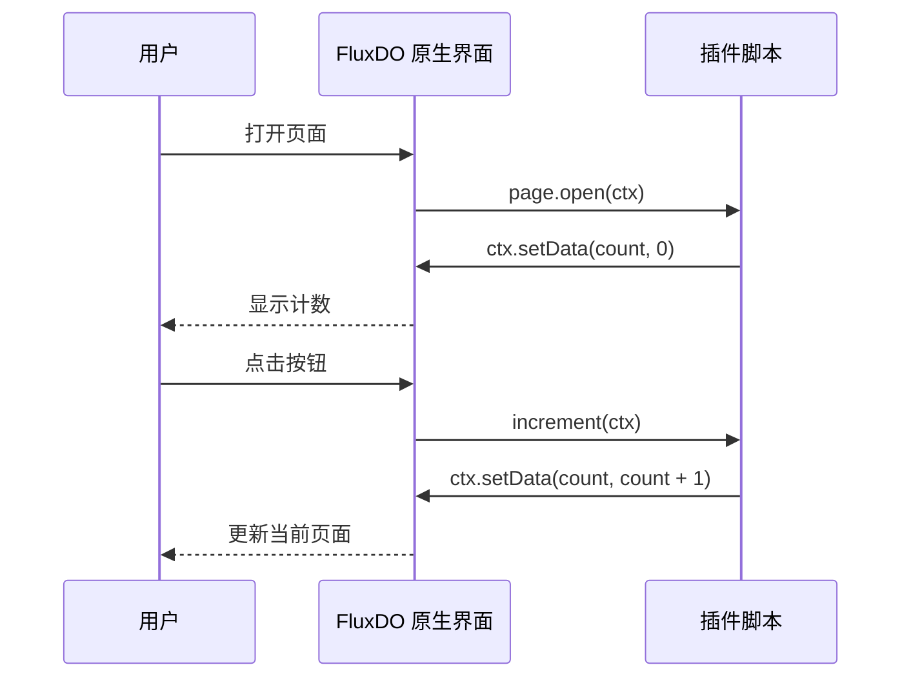

# 插件开发

用 TypeScript / JavaScript 编写逻辑，用 `ui.rfwtxt` 描述 Flutter 原生界面，通过受控的 `fluxdo` API 调用应用能力。插件作者只需 Node 24.11+，无需安装 Flutter；CLI、脚手架与 SDK 位于[独立工具仓](https://github.com/Lingyan000/fluxdo-plugin-tools)。

## 快速上手

工具首发候选为 **1.0.0，目前仍是草稿**。下列固定 URL 在 Release 公开后才可匿名下载；发行前维护者使用同批本地 tgz 验证，不要把草稿地址配置到在线市场。可用版本以[工具发行页](https://github.com/Lingyan000/fluxdo-plugin-tools/releases)为准，npm registry 尚未发布。

```sh
npx --yes --package=https://github.com/Lingyan000/fluxdo-plugin-tools/releases/download/v1.0.0/create-fluxdo-plugin-1.0.0.tgz create-fluxdo-plugin my-plugin --id example.myplugin --template basic
cd my-plugin
npm install
npm run check
npm test
npm run dev -- --lan 192.168.1.10
```

将 `192.168.1.10` 替换为开发机的局域网 IPv4。手机与电脑在同一网络，打开「元宇宙 → 插件管理 → 更多 → 开发中心 → 教程 → 连接开发工具」，扫码或粘贴配对地址，连接并审阅权限。Windows/Linux 使用粘贴；同机桌面和 Android USB 可用回环连接，见[开发工具与热更新](development-tooling.md#使用与边界)。

修改 `src/main.ts` 或 `ui.rfwtxt`，在应用里观察更新。组件页可调整参数和触发事件，API 页可修改请求参数并运行模拟结果，演示不使用真实账号执行交易。需要四语模板时将 `--template basic` 改为 `--template localized`。

```sh
npm run pack:plugin
```

从 `dist` 导入 `.fluxplugin`，审阅后安装、启用。系统打开方式见[文件安装](#文件安装)；上架流程见[发布与排错](publishing-and-troubleshooting.md)。

### 最小页面与事件

在脚手架项目中替换下面三个文件，保留生成的 `fluxdo.config.json`、TypeScript 配置与依赖。这是仅含页面的示例，不依赖网络或账号。

`plugin.json`：

```json
{
  "schema": 12, "apiVersion": 2,
  "id": "example.myplugin", "name": "计数", "version": "1.0.0", "author": "示例作者",
  "script": "main.js", "ui": "ui.rfwtxt", "permissions": {"network": []},
  "pages": [{"id": "main", "title": "计数", "widget": "Page"}]
}
```

`src/main.ts`：

```ts
const counts = new Map<string, number>();
fluxdo.on('page.open', ctx => {
  counts.set(ctx.surface, 0);
  ctx.setData('count', 0);
});
fluxdo.on('increment', ctx => {
  const count = (counts.get(ctx.surface) ?? 0) + 1;
  counts.set(ctx.surface, count);
  ctx.setData('count', count);
});
fluxdo.on('surface.close', ctx => { counts.delete(ctx.surface); });
if (import.meta.hot) import.meta.hot.accept();
```

`ui.rfwtxt`：

```text
import fluxdo;
widget Page = Column(crossAxisAlignment: "stretch", children: [
  Label(text: data.count, style: "headlineMedium"), Gap(size: 12),
  Button(label: "增加计数", onPressed: event "increment" {}),
]);
```



示例状态只存在当前脚本实例。持久计数应使用 `storage`；热替换需主动保留的模块数据使用 `import.meta.hot.data`，资源在 `dispose` 释放。正式脚本没有 Node、DOM 或运行时外部模块加载能力，依赖须打包进 `main.js`。

## 核心概念速查

| 版本字段 | 含义 |
| --- | --- |
| `version` | 插件发行版本，用语义版本比较更新，例如 `1.0.0` |
| `schema` | 清单结构版本，新插件使用 `12`；不会随产品版本重编号 |
| `apiVersion` | 脚本接口代次，新插件使用 `2` |
| `dataVersion` | 普通数据迁移版本，默认 `1`；显式声明须同时要求 `dataMigrations`，结构变化时递增并实现迁移 |

| 概念 | 职责 |
| --- | --- |
| 卡片、普通页面、弹层 | `card.widget` / `pages[].widget` 指向 RFW 组件。弹层是页面呈现方式，不是新的脚本上下文类型 |
| `ctx.surface` | 当前界面实例标识。卡片和多个页面共享脚本实例，状态须按 surface 分隔；关闭时释放资源 |
| `ctx.setData` | 只更新当前界面的瞬态 JSON 数据，不写磁盘 |
| `storage` | 普通 JSON 持久化，范围由 `storage.scopes` 与 `storage.default` 声明 |
| `credentials` | 由宿主保管登录凭据，仅按声明范围注入请求，不向脚本返回原文 |
| `requiredFeatures` | 必需能力协商；可选能力用 `ctx.api.host.features()` 探测。能力存在不等于已获权限 |

页面首次收到 `page.open`，普通返回和应用恢复收到 `page.resume`。是否刷新由业务变化决定，不要每次恢复就清空界面。`surface.close` 用于释放该页面状态。

## 文档导航

| 需要做什么 | 参考 |
| --- | --- |
| 查事件、网络、数据、授权和支付 | [脚本 API](api.md) |
| 选组件、配置参数、滚动和标题栏 | [原生组件](components.md)及应用内「组件」交互预览 |
| 连接设备、HMR、模拟宿主与诊断 | [开发工具与热更新](development-tooling.md) |
| 配置更新、备份、签名连续性与回退 | [定时更新与发布者信任](automatic-updates.md) |
| 签名、上架市场与定位常见错误 | [发布与排错](publishing-and-troubleshooting.md) |
| 修改 Flutter 宿主实现 | [宿主架构与安全边界](../metaverse-plugin.md) |
| 阅读纯 JS 与业务插件 | [最小 JS 示例](../examples/metaverse-plugin/)、[士多源码](https://github.com/Lingyan000/fluxdo-plugins/tree/main/plugins/ld-store) |

## 常驻导航、权限与市场发布概览

元宇宙首页和清单 `pages[].navigation` 声明的普通页面可由用户加入「设置 → 外观 → 底栏」，宽屏沿用配置显示在侧栏。声明不会自动改变布局。开发会话只预览，不注册正式导航。论坛动态示例见[工具仓](https://github.com/Lingyan000/fluxdo-plugin-tools/tree/main/examples/forum-activity)，只读数据与原生导航见 [API](api.md#论坛只读接口与原生导航)；名单、聚合、轮询和缓存属于插件。

界面、插件私有存储、声明域名内的普通联网和声明的前台任务属于基础能力。账号、服务登录、支付、论坛读取、后台、通知、链接接管和外部图片由用户分别管理。安装时审阅、使用时按需申请、以后随时关闭，详见[用户关闭权限时](api.md#用户关闭权限时)。开发预览使用同样分类，选择只在开发会话内生效。

公开分类可放共享区，订单草稿和订阅应放账号区。普通 `storage` 不保存登录凭据；显式分区及旧清单兼容规则见[普通存储作用域](api.md#普通存储作用域)。

默认目录为 [fluxdo-plugins](https://github.com/Lingyan000/fluxdo-plugins)。支持多个源、搜索分类、更新筛选、缓存和 ETag。市场摘要、作者签名和包内权限在下载后再次核对；作者签名不代表平台认证。跨来源安装单独确认数据影响。具体发布步骤见[发布与排错](publishing-and-troubleshooting.md)。

## 必需能力与资源边界

schema 10 起支持 `requiredFeatures`，市场索引必须与包内集合一致。宿主缺少必需能力时拒绝安装和运行，可选能力须探测后降级。能力集合由[运行时注册表](../../packages/fluxdo_plugin_runtime/lib/src/plugin_features.dart)维护。

| 资源 | 限制 |
| --- | --- |
| 清单 / UI / JS / 整包 | 32 KiB / 256 KiB / 512 KiB / 2 MiB |
| 每实例同步执行及其 Promise 微任务 | 5 秒原生截止时间 |
| JS 堆 / 栈 | 64 MiB / 512 KiB |
| 页面 | 默认最多 16 个，声明 `extendedPages` 后最多 32 个 |

每插件使用独立 QuickJS isolate，停止时中断原生执行并释放上下文。JS 堆限制不含 Flutter 图片、Dart 堆或普通存储，后者各有独立配额。引擎本身不提供网络、文件系统、Node 或 DOM；网络和凭证检查始终由宿主执行。

长列表使用 `ListPage`，长商品墙使用 `GridPage`，消息历史使用 `TimelinePage`；这些组件只构建可见和预取内容。少量嵌套卡片可用 `TileGrid`。`GridPage` / `TileGrid` 支持 natural、equalHeight、masonry，页面级滚动与 `scroll:false` 配置见[组件参考](components.md)。

### 日志与数据诊断

`console` 日志包含插件 ID、版本和运行实例；`ctx.api` 另关联 surfaceId。网络 `coreRequestId` 对应版本、实例、页面、traceId 和 attemptId。`emitter` 区分脚本与框架，`tag: core` 标识网络核心；共享连接维护等无请求归属日志留在应用网络日志。

每插件日志独立缓冲与轮转，最多两代各 512 KiB 文件；内存上限 128 KiB 或 256 条。超额丢弃该插件最旧记录并写汇总。插件管理支持查看、导出、仅清空当前插件日志和数据重置；日志清空覆盖旧共享文件与独立文件，清空期间新增记录保留。应用总日志可汇总所有分区。

## 历史兼容与手动打包

宿主兼容 schema 9–11；API 1 保留普通网络、界面与手填 token。旧服务专用授权和订单接口已移除，业务转入插件；旧记录通过迁移入口交由插件解释，详见 [API 1](api.md#api-1-手填凭证兼容)。

纯 JS 插件目录可直接放 `plugin.json`、`main.js`、`ui.rfwtxt` 三个文件。在应用仓根目录运行：

```sh
dart run tool/pack_metaverse_plugin.dart path/to/my-plugin build/my-plugin.fluxplugin
```

也可将三个文件部署到同一 HTTPS 目录，从应用导入 `plugin.json` 地址。`.fluxplugin` 是包含 `manifest` 和 `files` 的 UTF-8 JSON；客户端检查资源路径、大小、清单及 RFW 引用。新 TypeScript 项目优先使用独立 CLI。

### 文件安装

在「元宇宙 → 添加第三方服务 → 从文件安装」选择包，或从系统文件管理器打开 `.fluxplugin` 并选择 FluxDO。应用就绪后逐个显示权限审阅，取消后可再次打开，不会自动启用。

Android 文件管理器须提供读取授权和真实显示名称；Apple 平台导入结束后释放文件访问授权。Windows 便携版首次启动登记“打开方式”，Linux 安装包提供 MIME 描述和 desktop 入口。文件关联还取决于系统及文件管理器；无法直接打开时可使用应用内文件安装入口。
