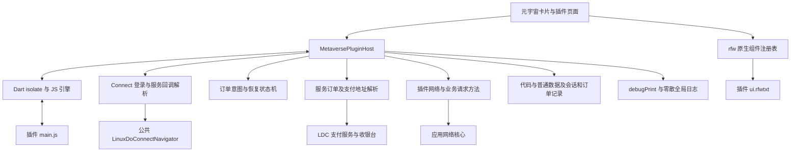
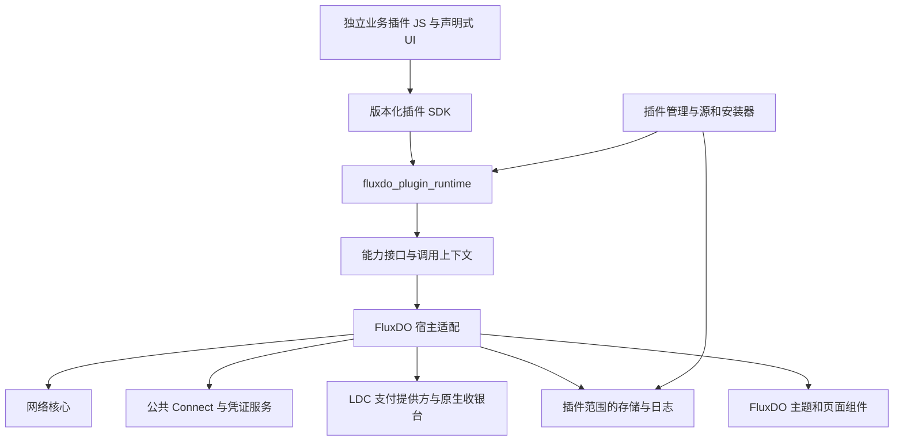

# 元宇宙插件架构审计与改造方案

首次审计日期为 2026-11-12，FluxDO 源码基线为 `8679b7ab`。下文「现状」与差距表保留首次审计结果，2026-11-13 的落地情况见末尾实施进度。竞品资料来自官方文档和公开仓库，改造回归使用模拟授权与支付。

## 结论与参考对象

建议围绕「声明式原生界面、受控宿主能力、独立业务插件」演进。现有 JS 和 rfw 可以继续承载这个目标，优先解决业务边界和完整生命周期，再增加插件分发入口。

| 参考对象 | 经核对的能力 | 对 FluxDO 的采用建议 | 适配成本或限制 |
| --- | --- | --- | --- |
| Raycast | List、Grid、Detail、Form 和 ActionPanel，声明式界面由原生渲染 | 高层组件、动作模型、加载状态和开发契约的首要参考 | React/Node SDK 与当前 JS/rfw 差异较大，采用组件语义需要自行实现 Flutter 适配 |
| VS Code | ExtensionContext、日志通道、存储范围、Secrets、版本兼容和 API 文档 | 插件管理、诊断、存储、SDK 文档体系的首要参考 | 桌面扩展宿主较重，需要按移动端生命周期缩小实现范围 |
| Tinycast | JavaScriptCore 与原生 SwiftUI，兼容部分 Raycast API | 参考 JS 到原生组件的桥接、按命令释放运行实例 | macOS 实现，与五平台要求有距离，Node 模块兼容层有持续维护成本 |
| Bob | 服务插件、更新清单、包版本与摘要、双击安装 | 轻量分发协议和文件安装体验 | 翻译服务接口的业务范围较窄 |
| STranslate | 独立插件 SDK、宿主上下文、日志和配置接口、社区插件仓库 | SDK 与应用隔离、插件开发仓库组织 | .NET 插件生命周期和隔离模型需重新映射到脚本运行时 |
| Kazumi | 规则目录、索引、规则 API 版本、可配置仓库 | 插件源地址规范化与静态索引 | 主要面向解析规则，复杂交互、授权和支付需另行设计 |

Raycast 的组件把搜索、列表、详情、表单和操作做成稳定契约，这与当前插件 UI 缺少统一页面级能力的问题最直接相关。[Raycast 原生 UI](https://developers.raycast.com/api-reference/user-interface)

VS Code 将扩展的数据目录、日志目录和安全存储纳入扩展上下文，API 参考从类型定义生成。FluxDO 可以借鉴这一管理边界，再使用自己的网络核心、主题和 Flutter 组件实现。[VS Code API](https://code.visualstudio.com/api/references/vscode-api)

Tinycast 的文档列出了组件兼容范围和已知限制，包括取消请求后底层仍可能执行。它可用于评估桥接实现的代价。源码核对版本为 `ede02bf33cfef586f7af8687cdf89fbeb720c297`，ExtensionRuntime 使用 JSContext，存储模型在 ExtensionStorage 中集中管理多类数据。[Tinycast 兼容说明](https://tinycast.dev/docs/extensions/compatibility/)、[运行时源码](https://github.com/abue-ammar/tinycast/blob/ede02bf33cfef586f7af8687cdf89fbeb720c297/Tinycast/Features/Extensions/Service/ExtensionRuntime.swift)

Bob 的更新清单包含版本、包地址、SHA-256 和最低宿主版本，用户可双击插件包安装，适合借鉴为第一版静态插件源。[Bob 发布流程](https://bobtranslate.com/plugin/quickstart/publish.html)、[Bob 安装流程](https://bobtranslate.com/guide/advance/plugin.html)

STranslate 提供独立的插件 SDK 和宿主上下文，插件可使用日志、HTTP 和设置服务。其独立插件开发流程值得用于设计 FluxDO 的模板仓库。[SDK 开发文档](https://github.com/STranslate/STranslate/blob/main/src/docs/plugin-sdk-development.md)、[社区插件开发文档](https://github.com/STranslate/STranslate/blob/main/src/docs/community-plugin-development.md)

Kazumi 核对到的主线版本支持仓库目录或 index.json 地址，并进行地址规范化。这里描述的是源码能力，发布版本需要另行对照。[仓库配置源码](https://github.com/Predidit/Kazumi/blob/4ca04009fdae696883629e0984e7d7134cc7ed84/lib/request/config/rules_repository_config.dart)

## 当前结构



插件目录共有 22 个 Dart 文件、6,886 行。登录、订单、订单类型、支付适配和会话这五个文件合计 966 行，这些文件混合了业务协议与通用机制。业务影响还延伸到清单、网络、存储、provider 组装及权限界面。文件行数用于定位审计范围，业务耦合需要按职责逐项判定。

### 进入宿主的业务概念

| 位置 | 已核对内容 | 建议归属 |
| --- | --- | --- |
| [metaverse_connect_login.dart](https://github.com/Lingyan000/fluxdo/blob/8679b7ab/lib/modules/metaverse/plugin/metaverse_connect_login.dart) | 服务初始化、回调、交换、验证、条款接口，`ldsp_oauth` 交接字段，用户标识和服务响应语义 | 士多协议进入插件。Connect 交互、回调关联和凭证保管进入公共能力 |
| [metaverse_checkout_types.dart](https://github.com/Lingyan000/fluxdo/blob/8679b7ab/lib/modules/metaverse/plugin/metaverse_checkout_types.dart) | productId、quantity、couponClaimId、expectedAmount 和 create/lookup 授权 | 商品与券模型进入插件，公共提交保障接收不透明业务参数 |
| [metaverse_checkout.dart](https://github.com/Lingyan000/fluxdo/blob/8679b7ab/lib/modules/metaverse/plugin/metaverse_checkout.dart) | `ord_` 提交号、exists/order/orderNo 字段、特定服务错误码和订单恢复状态 | 士多业务状态进入插件，事务记录和幂等支持抽成通用能力 |
| [metaverse_payment.dart](https://github.com/Lingyan000/fluxdo/blob/8679b7ab/lib/modules/metaverse/plugin/metaverse_payment.dart) | pending 订单、支付 URL 字段、paid/delivered/completed 状态映射 | 士多订单解析进入插件，LDC 凭证与付款验证由应用支付能力处理 |
| [metaverse_plugin_network.dart](../../lib/modules/metaverse/plugin/metaverse_plugin_network.dart) | `role=buyer`、payment-url、refresh、cancel 等请求规则 | 业务 URL 由插件构造，网络权限与出口策略由宿主和网络核心检查 |
| [metaverse_service_session.dart](https://github.com/Lingyan000/fluxdo/blob/8679b7ab/lib/modules/metaverse/plugin/metaverse_service_session.dart) | token、账号和过期时间与 query/checkout 授权绑定 | 通用凭证句柄与权限范围，业务能力由插件声明和使用 |
| [metaverse_plugin_manifest.dart](../../lib/modules/metaverse/plugin/metaverse_plugin_manifest.dart) | readSession、queries、checkout、payment 相互依赖 | 规范化宿主能力声明，业务接口定义留在插件 |
| [metaverse_plugin_store.dart](../../lib/modules/metaverse/plugin/metaverse_plugin_store.dart) | 普通数据之外还管理业务订单锁与提交记录 | 存储原语与业务记录分层 |
| [metaverse_plugin_providers.dart](../../lib/modules/metaverse/plugin/providers/metaverse_plugin_providers.dart) | 组装服务登录、订单适配与 LDC 收银台 | 宿主集成负责能力注入，服务协议交给业务插件 |

### 权限为何越来越多

`readSession` 限制带凭证请求只能 GET，报价需要 POST 后新增 queries，建单又新增 checkout，随后支付依赖 checkout。服务操作不断成为清单字段和权限文案，产生当前冗长的安装界面。`sameApprovalAs` 还比较 label、helpUrl 和 Connect 配置，展示资料变化也可能被算作授权变化。

下一版建议以「访问服务网络」「连接服务账号」「使用 LDC 支付」「读取论坛身份」「接管服务链接」等用户能理解的能力展示。后台仍保存具体域名、方法、路径、凭证附带规则和请求限制，安装页默认展示归类摘要，展开后查看细节。公开图片请求的匿名范围也应在网络详情中明确。

权限差异从规范化的能力范围计算。更新确实增加能力或扩大地址范围时展示增量授权。服务订单字段、优惠券和响应 JSON 结构由插件管理。

## 目标结构与代码隔离



建议先抽 `packages/fluxdo_plugin_runtime`，放置运行生命周期、RPC、调用上下文、能力接口、数据协议及 JS 引擎适配。通用协议层避免依赖论坛模型、LDC 服务、应用 provider 和业务订单类型。插件渲染适配与主题集成先保留在 `lib/modules/metaverse`，后续按实际复用需求抽独立 UI 包。

`lib/modules/metaverse` 适合保留应用入口、插件管理页面、路由和能力注入。`plugins/ld-store` 保存士多服务协议、商品、评论、订单与交付逻辑。插件可在独立仓库开发，仓库内目录用于随应用分发的版本。

包拆分建立可检查的依赖边界。运行时还需单独处理执行中断和内存限额。当前每插件有 isolate 和 5 秒看门狗，但正在执行的原生 JS 死循环可能持续占用线程，`Isolate.kill` 缺少可靠的原生执行中断保障。引擎适配中已有相关限制说明，应分别验证 QuickJS 与 JavaScriptCore 的终止和限额能力。[当前引擎适配](../../lib/modules/metaverse/plugin/runtime/flutter_js_script_engine.dart)

Raycast 使用扩展执行隔离，但官方明确说明 Node 文件和网络访问具有较大权限。其权限界面和运行机制要结合这一前提理解。FluxDO 的网络与凭证约束需要继续由宿主执行。[Raycast 安全说明](https://developers.raycast.com/information/security)

### 登录与支付边界

建议登录流程如下。

1. 插件请求服务的授权初始化接口，解析该服务返回的授权地址及会话关联参数。
2. 插件调用公共 Connect，宿主完成论坛账号交互和重定向关联校验。
3. 插件执行服务回调、交换和身份结果解析。凭证交换可通过受控网络管道将响应中的凭证写入安全存储，脚本取得句柄。
4. 后续请求引用凭证句柄，宿主检查插件归属、账号、目标范围和有效期。

公共 Connect 支持各接入方的回调契约。服务端返回错误、需要额外确认或尚未签发会话时，需要把准确阶段与原因返回插件。这种接口分工可参考 Raycast 的 OAuth 协调与扩展执行 token 交换的方式。[Raycast OAuth](https://developers.raycast.com/api-reference/oauth)

LDC 支付属于应用提供的具名能力。士多插件负责创建订单、获取支付会话、业务订单刷新和交付内容。宿主负责验证支付会话、金额、收款方和付款账号，展示原生收银台并处理密码与生物识别。插件提交的金额仅作待核对信息，服务端支付会话提供核验依据。

建议支付接口接收提供方标识、服务端签发的支付会话引用和预期展示信息。提供方适配负责验证，返回统一的成功、取消、待确认或失败结果。支付密码和生物识别解锁材料保存在宿主支付层。新支付提供方需要具名适配，普通商城接入使用已有能力。

原型阶段直接修订 SDK 和清单协议，并同步迁移士多插件及测试。订单提交与结果恢复归业务插件，LDC 收银台归应用公共能力。

## 插件日志管理

### 现状

- 插件 console 进入 `MetaversePluginHost.log` 后仅调用 debugPrint，正式版在 main.dart 中关闭该输出。
- 授权诊断写入全局日志，但 pluginId 主要嵌在文本里。网络诊断没有稳定的插件归属字段。
- 公共 LogWriter 有缓冲、轮转、脱敏和全量清空，缺少插件范围清空。重复合并和超长记录裁剪还会丢掉未列入保留集的上下文字段。
- 现有日志页面按级别、类型和文本筛选。通过关键词筛选无法覆盖共享域名、异步调用和框架内部失败。

相关实现见 [宿主日志桥](../../lib/modules/metaverse/plugin/metaverse_plugin_host.dart)、[LogWriter](../../lib/services/log/log_writer.dart)、[LogPolicy](../../lib/services/log/log_policy.dart)、[日志页面](../../lib/pages/app_logs_page.dart)。

### 设计

每次运行创建宿主管理的调用上下文。记录至少包含 `pluginId`、`pluginVersion`、`runtimeId`、`surfaceId`、`emitter`、`module`、`event`、`traceId`，网络记录再关联 requestId/coreRequestId。`emitter` 标明 plugin、framework 或 service/core，pluginId 标明这条请求的发起归属。二者同时保留，方便查出「哪个插件调用时，框架哪一步失败」。

脚本只能提交级别和消息，身份字段由宿主填写。上下文显式经过公共网络适配传递，共享连接的纯连接级日志可以独立存在，通过请求关联追踪。重复聚合的键必须包含归属字段，裁剪、导出和错误路径保留这些字段。

复用现有日志写入、脱敏和轮转机制，增加插件范围的存储通道。应用日志页聚合读取，插件详情提供当前插件视图，支持级别、来源、时间和请求链筛选。诊断面板提供复制脱敏记录、导出及「清空此插件日志」。

真正清空需覆盖当前文件、轮转文件和未刷新的缓冲。写入与清理通过同一串行队列和日志代次协调，清理前缓冲被丢弃，清理后产生的新事件正常保存。日志配额和限流按插件实施，超限记录聚合计数，保留错误诊断能力。

授权码、token、Cookie、支付密码和完整响应体默认进入受保护的处理路径。网络诊断优先记录状态、阶段、耗时和脱敏地址。沿用 LogPolicy 并补充插件身份保留规则。

## 插件数据管理

### 现状

| 数据 | 当前位置或归属 | 缺口 |
| --- | --- | --- |
| 插件代码 | 应用支持目录 `metaverse_plugins/<id>/main.js` 与 `ui.rfwtxt` | 两文件顺序写入，更新事务缺少原子切换 |
| 普通数据 | 同目录 `storage.json`，256 KiB 配额 | 插件级共享，账号范围由插件自行管理，并发写入可能覆盖 |
| 凭证 | SecretStore 的 `metaverse_plugin` 命名空间 | 已有内部删除接口，管理入口和重置流程待补 |
| 未决订单 | SecretStore 的 `metaverse_orders:<id>` 命名空间 | 业务记录与基础存储耦合 |
| 安装索引 | SharedPreferences `metaverse_plugins_v1` | 来源、启用和清单信息需要事务协调 |
| 网页会话 | 对应浏览器会话存储 | 需要明确站点范围及共享会话语义 |
| 生物识别付款凭证 | 应用 LDC 支付能力，按付款账号管理 | 管理入口属于应用支付设置 |

当前图片组件主要使用组件状态和内存图片缓存，源码中没有单独的插件磁盘图片缓存目录。管理界面的空间统计应基于实际资源归属。

`clearStorage`、`clearOrders`、`deleteToken`、`deleteFiles` 已有底层实现。现有卸载流程缺少统一的任务取消和存储代次屏障，进行中的写入可能在清理后落盘。普通 storage 写入采用复制后保存，也存在并发丢失更新的静态风险。

### 管理动作

| 动作 | 操作范围 |
| --- | --- |
| 清空日志 | 当前插件日志文件、轮转和缓冲 |
| 清理缓存 | 明确标记为可重建的插件缓存 |
| 退出服务账号 | 当前插件对应账号的会话、凭证与相关账号缓存 |
| 重置插件数据 | 停止运行，删除普通数据、插件会话、缓存与本地业务记录，重新初始化 |
| 卸载 | 停止运行，删除插件代码、索引和该插件拥有的数据及日志 |

管理页显示各类数据占用和账号范围。重置如涉及本地未决提交，应说明会删除本机恢复记录，并提供查看相关记录的入口。服务端订单后续按服务接口查询。涉及共享网页会话时展示站点和影响范围，使用支持的站点级清理接口。

实现顺序为暂停新调用、取消或隔离正在执行的任务、递增存储代次、串行删除、提交索引状态，再按用户操作重新初始化。旧代次的网络回调和凭证写入必须拒绝落盘。普通数据写入采用按插件排队与临时文件替换，错误文件保留诊断依据。

## 安装、插件源与更新

### 现状中的直接问题

`.fluxplugin` 当前是 UTF-8 JSON 容器，手动文件安装和 HTTPS 清单安装已具备。随应用插件从 AssetManifest 扫描，自动更新候选主要来自这些内置资源。自定义插件源订阅、源管理和远程版本索引尚未实现。[安装器](../../lib/modules/metaverse/plugin/metaverse_plugin_installer.dart)、[插件管理 provider](../../lib/modules/metaverse/plugin/providers/metaverse_plugin_providers.dart)

文件导入将 `bundle:<包内容 SHA-256>` 保存为 source。升级改变内容摘要，随后 `changedSource` 路径清理 token、普通数据和订单。这里混淆了发布来源身份与版本内容摘要，应优先修复。包更新还需 staging 校验和版本目录原子切换，索引提交失败时能恢复上一完整版本。

### 数据源形式

用户添加的「插件源」用于发现插件、查询版本和下载安装包。插件运行时访问的商品、文章等「业务数据源」由插件配置管理。两类地址分别进入源管理与插件设置。

第一版推荐 HTTPS 静态索引，支持输入仓库目录或完整索引 URL。宿主统一规范化地址，通过插件源适配器读取版本描述。可先提供默认社区源和用户自定义源，后续加入搜索、分类和评分服务。

客户端已支持 schemaVersion 1 的静态索引，默认仓库为 `Lingyan000/fluxdo-plugins`。下面是最小条目的结构示例，真实发布需填写完整摘要。

```json
{
  "schemaVersion": 1,
  "name": "示例插件源",
  "plugins": [
    {
      "id": "org.example.notes",
      "name": "笔记",
      "summary": "记录本地备忘",
      "author": "示例作者",
      "repository": "https://github.com/example/plugins",
      "version": "1.0.0",
      "apiVersion": 1,
      "packageUrl": "https://plugins.example.org/notes/1.0.0.fluxplugin",
      "sha256": "实际发布时填写完整的64位十六进制摘要"
    }
  ]
}
```

安装记录分别保存稳定 pluginId、来源记录、发布者信息、版本和内容摘要。来源声明与发布者身份之间还需可信关联，SHA-256 用于内容完整性校验。同 ID 被其他源提供时，安装界面显示来源冲突和切换影响。来源信任策略、签名和源迁移规则应独立设计。

更新检查比较版本、宿主 API 兼容范围和权限增量，下载后校验摘要、包结构与资源引用。数据迁移提交与代码版本切换一起管理。同源正常升级具有稳定的安装身份，迁移后的账号和业务记录经过兼容验证。

### 直接打开文件安装

当前文件选择入口位于元宇宙页，系统文件关联和冷启动接收需要补齐。统一入口应接收文件流，复用现有 2 MiB 包限制、清单校验和权限预览，用户确认后执行安装事务。

| 平台 | 需要接入的路径 |
| --- | --- |
| Android | intent-filter 与冷暖启动 Intent，支持 content URI，通过 ContentResolver 读取名称、MIME 和文件流 |
| iOS | Document Types、UTType 与打开文件回调，处理文件访问授权生命周期 |
| macOS | Document Types、UTType、打开文件事件及对应沙箱访问 |
| Windows | 包装形式对应的文件关联、启动参数及现有实例转发 |
| Linux | MIME 描述、desktop 文件的 Exec 参数及运行实例接收 |

来源文件的 MIME 和扩展名只用于发现入口，实际内容由安装器验证。打开事件在应用就绪后排队，处理重复事件、取消、损坏包和授权失效。[Android 文件元数据](https://developer.android.com/training/secure-file-sharing/retrieve-info)、[Apple Document Types](https://developer.apple.com/documentation/bundleresources/information-property-list/cfbundledocumenttypes)、[Windows 文件激活](https://learn.microsoft.com/en-us/windows/apps/develop/launch/handle-file-activation)

## 开发体验与管理入口

应用建议增加「元宇宙 → 插件管理」，包含已安装、发现和源管理。插件详情包含版本、来源、能力、设置、账号、日志和数据管理。卡片更多菜单直接进入该插件详情与日志，日常业务动作仍放在卡片和插件页面中。

开发文档放在插件管理的可见入口，指向与宿主 SDK 匹配的文档版本。仓库入口已整理到 [插件开发](README.md)，其中 [API](api.md) 和 [组件](components.md) 覆盖当前公开接口。后续补充类型定义、清单 JSON Schema、错误码参考、调试预览和独立模板仓库。类型与组件元数据生成参考页，CI 检查导出项覆盖，减少手工维护漂移。

高层组件优先补列表页、详情页、表单页和统一动作定义，负责搜索、分页、错误、空态、底部操作及无障碍。插件提供数据、字段约束和动作处理。适配应用的字体、主题、安全区域与桌面交互，统一检查窄屏、大字体、键盘及滚动表现。

建议提供独立预览宿主，使用可替换网络响应与会话模拟调试插件。真实 Connect 和 LDC 联调继续经过应用能力，支付测试覆盖确认前流程及模拟结果。

## 差距与执行顺序

| 能力 | 当前状态 | 下一步验收 |
| --- | --- | --- |
| 动态加载与原生界面 | 已有 JS、rfw、卡片和多页面 | 独立插件目录可打包安装，运行生命周期稳定 |
| 通用业务边界 | 服务协议进入多个通用模块 | 第二个非商城插件用异构认证和写接口接入，通用层无需增加该服务判断 |
| 诊断归属 | 正式版 console 丢失，网络归属不完整 | 两插件访问同域名也能按调用链准确归属和独立清空 |
| 数据管理 | 有底层删除函数，缺少完整管理流程 | 并发写入、退出和重置后旧任务无法恢复已删除数据 |
| 更新身份与事务 | 内容摘要参与来源识别，顺序写文件 | 同源更新保留稳定身份，失败恢复完整旧版本 |
| 开发文档 | 本次补齐当前接口参考 | SDK 元数据生成与自动覆盖检查，预览和独立模板可用 |
| 页面级组件 | 以布局和基础控件为主 | 一套列表、详情、表单和动作覆盖多种业务并符合主题 |
| 插件源与文件关联 | 手动导入可用，系统入口和订阅待补 | 五平台冷暖启动安装，源冲突和版本兼容可诊断 |
| 执行资源控制 | isolate、调用限额、看门狗已有，原生中断有局限 | 各平台死循环、内存增长和取消行为有可验证结果 |

第一批处理日志归属、数据重置屏障、稳定安装身份和原子更新。它们直接影响排错和用户数据。

第二批迁移士多业务协议，抽运行时包和公共能力接口，引入 SDK 版本与依赖守卫。迁移时同时更新示例插件、契约测试与文档，并明确新包所需的宿主 API 版本。

第三批完善高层原生组件、插件管理页面、类型定义和预览工具，同时用第二个异构插件验证契约。界面细节结合应用公共组件实施。

第四批接入静态插件源、更新管理和五平台文件激活。扩大分发前完成资源终止、日志配额和数据隔离验证，并明确平台差异。

### 重点回归

- 两个插件共用域名和网络连接时，各自日志、凭证、数据和清理范围准确。
- 清空日志期间有缓冲和轮转，完成后旧记录不会再次出现，新记录正常写入。
- 重置期间发生 storage 写入、授权回调、订单回查，旧任务被代次校验阻止落盘。
- 旧版本包、旧会话和未决订单可迁移，同来源正常更新、权限增量和来源切换分别处理。
- 插件安装中途失败或退出，重启后具有完整可运行版本和一致索引。
- 直接打开包覆盖冷启动、暖启动、重复事件、损坏内容、超大内容及文件访问失效。
- SDK 导出方法、注册组件、文档和最小示例一致，未知 API 版本给出明确兼容提示。
- 登录、支付成功与待确认、取消、建单重试和交付刷新通过模拟覆盖，真实验证止于付款提交前。
- 架构守卫检查运行时包依赖、业务域名与服务模型归属，并用不同协议的插件回归通用性。

## 2026-11-13 实施进度

已同步 dev `26d7f30d`，提取独立 Dart 运行时协议包，接入结构化插件日志、插件范围导出与清空、串行存储、数据重置及代码摘要版本切换。原生市场、GitHub 索引与发布校验、插件设置、应用内交互开发中心已接通。

市场仓库 [Lingyan000/fluxdo-plugins](https://github.com/Lingyan000/fluxdo-plugins) 已发布士多 1.6.6 和用于演示离线存储的随手记 1.0.0。GitHub Actions 检查目录格式、插件内容与下载摘要。应用内组件页覆盖 20 个生产组件，API 页提供 22 个可执行的隔离示例。

插件、日志与架构测试共通过 297 项，2 项真实网络测试因未启用环境开关跳过。静态检查无 error/warning，日志页仍有 7 项既有大括号风格提示。市场另以实际中文字体检查窄屏、大字体和明暗主题。当前验证范围为桌面测试环境，五平台运行效果尚需设备验收。

API 2 已提供具名凭证、Connect 回调、PKCE、UUID 和应用 LDC 收银台。凭证按插件及账号隔离，通过 origin、路径与方法限制注入，撤销或清空会阻断晚到响应写回。公共收银台通过 LDC 交易 ID 核验支付结果，插件随后刷新交付。第二个异构服务的模拟协议已通过真实 JS 桥完成凭证交换与带凭证写请求。

开发中心新增 8 个 API 2 示例，共 30 个，分别验证成功与失败。该阶段插件、支付、日志与架构回归共通过 331 项，2 项实时网络测试跳过。验证使用模拟传输与支付响应。

士多 2.0 的授权初始化、HTML 回调、PKCE 交换、身份核验、报价、订单幂等记录、支付链接和交付刷新已迁到插件脚本，清单切换到 API 2。新增 28 项真实 JS 登录协议测试、5 项订单协议测试，相关回归共 364 项通过，2 项实时网络测试跳过。原生页面用例覆盖直接建单、自动进入订单、取消确认与付款结果回查。

旧开发版持久记录已通过通用迁移入口原样交给所属插件，士多脚本按账号恢复原提交号。批量存储一次提交，迁移摘要防止已消费记录被重新导入，安装失败时保留旧加密副本。开发中心补充批量存储与 SHA-256 示例，共 32 个。插件、支付、日志、存储及架构回归通过 381 项，2 项实时网络测试跳过。

宿主旧的服务授权、订单模型、提交记录锁和订单请求实现已删除，SDK 移除具名业务查询与 checkout。API 1 继续兼容通用界面、网络及手填 token。旧业务插件保留在管理列表，启动前提示升级，同源升级经过原始记录迁移。最小示例已改为 API 2，开发中心保留 21 个公共能力示例。原业务适配测试由插件脚本协议测试接替，并增加服务地址归属和宿主业务接口守卫。当前相关测试通过 307 项，2 项实时网络测试跳过，静态检查通过。

高层 UI 组件扩展和网络核心完整日志归属尚待完成。运行时原生脚本中断与内存硬上限仍受现有引擎约束。

公共目录已发布士多 2.0.0 与随手记 1.0.1，标签 `plugins-2026.11.13-api2` 标记为预发布，需要支持 API 2 的应用版本。两个附件经过真实安装器检查和远端下载摘要验证，目录仓库提交为 `44f3523`，GitHub Actions 发布校验通过。真实账号、付款前流程和五平台运行效果仍待设备验收。

五平台已接入 `.fluxplugin` 文件打开代码和系统声明。统一安装队列等待启动界面就绪，合并重复激活，串行展示权限页。Android 通过 ContentResolver 校验显示名称并限量读取，Apple 共享文件读取实现保留并释放访问授权。Windows 使用整批确认的实例转发，Linux 使用独立 GApplication 文件通道。

文件队列、平台读取、安装确认/取消、原生组件、深链和架构回归通过 71 项。Android 通道通过 Kotlin 定向编译，Windows 通过 MSVC 检查和批次接收实验，Linux 通过 GTK 编译及两个进程的实际 D-Bus 文件交付实验。Apple 文件声明与工程引用已核对，当前 Windows 环境尚未执行 Xcode 编译。各系统文件管理器的实际打开行为仍需设备验收。

额外检查小程序启动时，3 项通过，1 项在测试绑定重复初始化处失败。相同用例在提交 `12386b94` 的干净源码快照中复现，文件入口变更前已存在。
